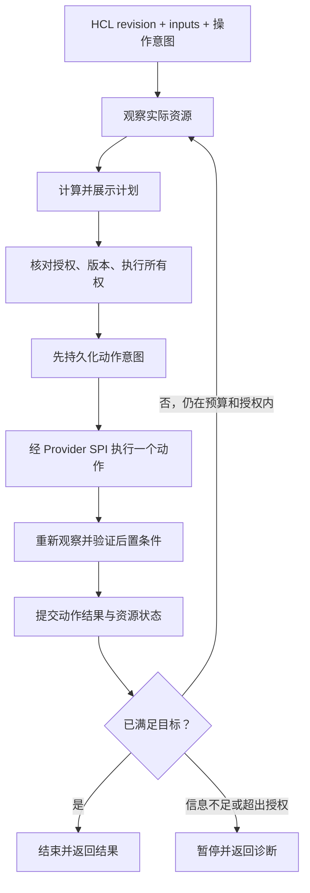

# Sysbox 重构方案：以真实状态驱动生命周期收敛

> 日期：2026-09-28
> 状态：目标架构设计；正在分阶段实施。实际交付边界见[实施状态](2026-09-28-runtime-refactor-implementation-status.md)，不能将本文全部目标视为已完成。
> 本文取代[前版方案 B](../superpowers/specs/2026-09-28-sysbox-architecture-refactor-design.md)作为本轮重构依据。原有架构文档仍描述当前实现，本文描述目标。
>
> 接口兼容边界见[接口变更清单](2026-09-28-interface-change-inventory.md)。

## 1. 一页看懂这次重构

**目标：用户声明实验环境应该是什么样，Sysbox 观察它实际是什么样，在授权范围内执行差异动作，并验证结果。进程重启后，同一套引擎能够继续完成工作。**

项目继续定位为声明式异构实验环境编排系统：管理节点、网络、镜像以及 guest 操作，支持 CLI 和 API/Agent。第一版采用按请求运行的有限收敛流程，不引入必须常驻的自动修复控制器。



本轮不是把所有代码推倒重来，而是统一执行规则：

| 保留并加强 | 重构或移除 |
|---|---|
| HCL、资源地址、依赖图、schema 与差异计算 | refresh 与 checkpoint recovery 各自决定恢复动作 |
| `driver.Descriptor` 与 capability 接入机制 | runtime 直接理解 provider 私有进程和路径 |
| `ObserveNode`、`AdoptNode`、provider state codec | 依赖内存句柄才能完成的生命周期操作 |
| revision、操作去重、lease、CAS 的已有基础 | 三套存储后端各自实现业务状态转换 |
| exec、文件操作、Console 等能力 | API guest exec 与 provisioner 的执行语义分叉 |

## 2. 先纠正对现状的简化描述

当前 Sysbox 已经具备声明式规划、实际资源观察和恢复日志，并非纯粹按步骤执行的脚本。重构要解决的是这些机制没有形成一致的闭环。

| 当前代码证据 | 现有基础 | 重构着力点 |
|---|---|---|
| [plan.go](../../pkg/runtime/plan.go) | 依赖图、配置差异、能力检查 | 把完整观察结果作为规划输入 |
| [refresh.go](../../pkg/runtime/refresh.go) | 查询真实资源，保留 unknown | 当前主要刷新 noop 项；统一创建、替换、删除前的观察 |
| [recovery_policy.go](../../pkg/runtime/recovery_policy.go) | refresh/checkpoint 恢复决策 | 让恢复与普通执行使用相同决策规则 |
| [transaction.go](../../pkg/runtime/transaction.go)、[execution_journal.go](../../pkg/runtime/execution_journal.go) | checkpoint、外部 ID、state patch | 统一写前意图、持久化错误与结果不明处理 |
| [Firecracker node.go](../../pkg/provider/firecracker/node.go) | 已有冷路径观察、PID anchor 和 AdoptNode | 完善身份校验与跨进程生命周期，不能误称为完全无法恢复 |
| [Firecracker pause.go](../../pkg/provider/firecracker/pause.go) | pause/resume 依赖内存中的 cmd | 接管后的节点也能执行受支持操作 |
| [revision_snapshot.go](../../pkg/api/revision_snapshot.go) | 已有不可变 revision 发布 | 替换 workspace 的先删后写路径 |
| [guest_operation.go](../../pkg/agentexec/guest_operation.go) | API/check 走 GuestExec | 与 provisioner 的 Connection 共享执行实现 |

同样，`ReadNode` 不支持 import，不等于不能恢复 Sysbox 自己创建的资源。外部资源导入与已管理资源的接管必须分开。

## 3. 三个核心设计决定

### 3.1 一次请求，一次有限收敛

CLI 和 Agent 调用相同 runtime 引擎；API 负责接收意图、授权、调度和展示，不在 handler 中实现第二套恢复算法。

每个 run 固定 revision、输入引用、目标 generation、作用范围、动作预算与截止时间。失败重试有次数与退避上限；遇到没有进展、权限错误、存储错误或结果不明就结束本轮并留下可诊断状态。

后台 supervisor 默认只观察和报告。未来若增加自动修复，必须显式配置允许的动作、频率和维护窗口，复用本引擎，不默认获得 replace、reset 或任意 exec 权限。

### 3.2 观察驱动决策，journal 记录未完成的意图

观察回答“现在是什么”；journal 回答“曾经授权并尝试了什么、是否还有结果未确认的动作”。两者都不可缺少。

外部 provider 与 Sysbox 数据库之间没有共同事务。容器可能已经创建，但响应或 state 写入失败。此时不能因为数据库没有记录就再创建一个，也不能只凭 journal 的 success 字段认定资源仍然健康。

目标语义是：可验证动作允许重试与去重；不能验证的动作显式标记结果不明。**不承诺通用的 exactly-once 外部执行。**

### 3.3 保留 SPI 扩展点，统一其行为契约

新 substrate 仍通过实现接口、声明能力并注册 descriptor 接入。保留这个扩展机制，不承诺本次破坏兼容重构前后的每个 Go 方法签名完全不变。

runtime 决定“为什么需要启动或修复”；provider 决定“怎样在 Docker、Firecracker 或 libvirt 上完成动作”。Firecracker manifest 不进入通用 runtime 的类型断言或分支。

## 4. 谁负责什么：目标分层

```text
CLI / API                           用户意图、授权、结果展示
    │
Run Service / Agent Dispatcher      去重、排队、placement、分发
    │
Runtime Engine（CLI 与 Agent 共用）
    ├── Observer                    收集事实与身份验证结果
    ├── Planner                     纯决策：差异、依赖、动作和理由
    ├── Action Runner               意图落盘、执行、验证、重试控制
    └── Recovery                    找未完成动作后进入同一执行闭环
    │                              │
Domain Repository Ports            Driver / Substrate SPI
    │                              ├── Docker
Shared transitions / codec          ├── Firecracker
    │                              └── libvirt
Filesystem / SQLite / Postgres
```

关键依赖约束：

- runtime 不依赖 `pkg/api`、SQL 驱动或 provider 具体包。
- repository 接口由消费者或中立领域包定义；adapter 依赖接口，业务不反向依赖 adapter。
- 领域类型不能被放进 API 包后又让 runtime 导入，避免循环依赖。
- 共享纯函数处理状态转换；实际 CAS、事务隔离、唯一约束必须由后端实现。
- 首期每个 topology 串行执行 mutation；不同 topology 可并行。先保证恢复语义，再扩展同拓扑并行度。

## 5. 数据模型：拆开目标、身份、事实和执行历史

| 数据 | 内容 | 责任与权威范围 |
|---|---|---|
| DesiredRevision | HCL tree、输入引用、内容摘要 | 用户提交的不可变目标；不是当前运行事实 |
| ResourceIdentity | topology UID、资源地址、driver、generation、external ID、owner UID | 标识谁被管理，防止重名与跨代误操作 |
| Observation | 存在性、运行态、ready 条件、时间、来源、诊断 | provider 本次查询得到的事实 |
| ResourceRecord | identity、已知依赖、provider 私有持久数据、最新 observation | identity 与依赖必须可靠保存；observation 是可刷新的快照 |
| OperationJournal | action ID、目标摘要、重试语义、身份预期、意图与结果 | 恢复未完成操作；不能当作实时状态 |
| ProviderManifest | 本机路径、generation、启动配置、进程归属锚点 | provider 的恢复材料；记录 running 不证明仍在运行 |
| RuntimeHandle | exec.Cmd、pidfd、连接、锁等进程内对象 | 缓存，不持久化，也不作为身份来源 |

通用 state 不能整体降级为可丢弃的“显示缓存”：资源身份、管理范围、依赖、替换 generation 仍然是必要持久数据。只有观察快照和显示 projection 可以重新生成。

三个版本分开：schema version 表示存储格式；record version 用于 CAS；resource generation 表示一次资源实例代际。run 重试增加 attempt，不自动增加 generation。

### 5.1 观察状态不要混成一个布尔值

目标 observation 分开表达：

- 存在性：present / absent / unknown。
- 身份：verified / conflict / unknown。
- 运行态：prepared / running / stopped / paused / exited / unknown。
- 条件：guest ready、网卡就绪、路由收敛及各自诊断。

drift 是 Planner 比较目标和事实得到的差异，不是“进程还活着”的反义词。unknown 与 unhealthy 也不等于 absent。查询失败时保留上次快照，但标注过期，不能拿它批准删除或重复创建。

## 6. 计划和动作：正常执行与恢复共用一套规则

### 6.1 Plan 的输入与输出

输入包括固定 revision、解析后的目标、依赖图、资源身份、近期 observation、未完成 journal 和操作策略。没有 state 的资源也需要按 ownership/action identity 做有界发现，不能直接推断真实资源不存在。

Plan 输出动作 DAG、原因、风险、前置条件、后置条件和允许的重试模式。创建按依赖正序，删除按已持久化依赖逆序；依赖不完整时不猜测清理顺序。

Plan 绑定 revision digest、输入引用/版本、state serial、generation 和能力契约版本。执行前在取得所有权后重新检查。新增删除、替换或扩大目标范围时原计划失效；不能借“自动收敛”悄悄扩张已批准的计划。

### 6.2 动作状态机

```text
planned → intent_committed → executing → verifying → succeeded
                              │             │
                              ├─ 明确失败 ──┴→ failed / retryable
                              └─ 响应丢失或崩溃 → uncertain → observe
                                                           ├─ 已完成：提交结果
                                                           ├─ 未完成且可重试：重试
                                                           └─ 无法证明：blocked
```

这里的 failed、uncertain、blocked 是不同结果。命令返回错误不证明副作用没有发生。

| 动作类型 | 可采用的恢复策略 |
|---|---|
| 可读、无副作用的观察 | 有界重试 |
| 确保资源存在、确保路由等 | 先观察；身份与目标匹配后幂等重试 |
| 创建资源 | 固定 action ID / generation，并通过标签、UUID 或 manifest 定位既有结果 |
| replace / reset / destroy | 明确授权、归属校验、分步 journal；不能自动扩大作用范围 |
| 任意脚本、后台 guest 命令 | 默认不可自动重放；无可靠结果证据时返回 uncertain |

### 6.3 单个动作的提交边界

1. 取得 topology 执行权，检查 generation、计划前置条件及未完成动作。
2. 持久化 action intent，包括稳定 action ID、owner UID、预期身份与重试策略；失败则不调用 provider。
3. provider 在其本地操作锁下执行，传播 deadline/cancel；不持有长时间 SQL 事务等待外部操作。
4. 重新 observe，确认后置条件；未确认不能写成 succeeded。
5. 在同一后端事务中提交 action 结果、资源记录与 outbox。状态 CAS 冲突则重新读，不用旧快照覆盖。
6. 发布通知失败由 outbox 重投，不重做 provider 动作。

外部动作完成、步骤 5 尚未提交时崩溃：新执行者读取步骤 2 的意图，通过 stable identity 查找资源并 observe，再补交结果。无法唯一定位就停止，不创建第二份。

### 6.4 使用者看到的行为

| 场景 | 目标行为 |
|---|---|
| apply：配置未变，实际资源符合目标 | noop，不重复运行 provisioner |
| VM 已创建，尚未启动，CLI 崩溃 | 重新发现同 generation 的 VM，补齐缺失动作 |
| VM running，但 ready 尚未满足 | 有界等待与诊断，不直接 replace |
| VM 已退出 | 按显式启动/恢复策略重启或报告，保留磁盘 |
| observe 权限不足或连接超时 | unknown，阻止依赖该判断的 mutation |
| destroy 已删除资源，结果提交前崩溃 | 验证 absent 后写 tombstone，再清理依赖 |
| reset | 对指定资源产生一个固定的新 generation，重试沿用同一 generation |
| pause/resume | 持久化运行态意图；默认以 paused 意图为准，后续 apply 不偷偷恢复 |
| guest exec 超时或断线 | 返回结果不明/取消语义，不承诺远端进程已经结束 |

recover 重新观察并继续同一目标；reset 才是从基线重建。两者不能共用一个“出错就重建”捷径。

## 7. 并发、lease 与跨进程执行权

CAS 只阻止数据库覆盖，不能阻止两个 worker 同时调用 provider。需要两个层面的保护：

| 层面 | 机制 |
|---|---|
| 控制面 | 每 topology 的 lease、递增 epoch、run 去重与条件提交 |
| Agent/CLI 实际执行入口 | 同一宿主机上的 topology/resource 操作锁、当前 epoch 校验、未完成动作检查 |

worker 失去 lease 后停止开始新动作。已发出的 provider 调用可能仍在执行，因此继任者必须先确认旧执行者已停止，或确认动作结果。provider 不支持 fencing 时，数据库 epoch 不能被描述为完全阻止了旧 worker 的副作用。无法确认时阻塞接管，不并发重试。

Firecracker 修复包含进程内与进程间两部分：短时 registry map 锁只用于查找；每 VM 操作锁串行化 start/stop/destroy；进程字段在统一锁下读写，观察返回不可变快照。不同 CLI 进程还需共享宿主机锁。耗时探测不能阻塞所有 VM 的全局锁；Wait 只由启动该 child 的 reaper 调用。

CLI 直连模式与 Agent 模式必须共享本机锁命名与 ownership 规则。拓扑已交给 Agent 管理时，本地 CLI 默认转发或拒绝旁路 mutation。首期不支持同一 topology 自动跨主机故障切换。

## 8. 存储重构：保留方案 B，收紧事务边界

### 8.1 共享业务规则，保留具体仓储端口

采用 RunRepository、TopologyRepository、ExecutionRepository 等按聚合划分的接口，避免万能 `Repository[T].Update(fn)`。重试 callback 容易重复副作用，也会掩盖跨记录的事务要求。

| 端口操作（设计名称） | 必须保证的原子性 |
|---|---|
| CreateRunDispatch | 请求去重、run、初始 command/outbox 同时提交 |
| ClaimRun / RenewLease | owner、epoch、版本、过期条件一起验证 |
| CommitActionIntent | 意图与 action identity 在调用 provider 前可靠落盘 |
| CommitActionOutcome | journal 结果、ResourceRecord、通知 outbox 同时提交 |
| CompleteExecution | 执行结果与版本推进，不覆盖终态 |

共享层包含纯状态转换、版本化 codec、验证、错误分类和稳定列表排序；adapter 实现原子提交、唯一约束和查询优化。SQL 条件更新不能降级为普通 Get + Put。

### 8.2 避免 API 数据库与 topology state 双重提交

目标中，同一部署的 run journal 与 topology ResourceRecord 使用同一个选定的持久化后端，由一个提交边界写入。`pkg/state` 保留领域模型和导出职责，但不再与 API store 各自提交同一动作的两份权威状态。

API 展示的 status/health 是 projection；projection 可异步刷新并携带 observedAt，不参与批准破坏性动作。导出的 state JSON 是交换/诊断产物，不成为运行时第二个写入主副本。

### 8.3 三种后端的明确范围

| 后端 | 目标范围 | 实现要求 |
|---|---|---|
| Filesystem | 单机、小规模本地拓扑 | 每 topology 一个版本化聚合 snapshot，覆盖 run/action/resource/outbox；进程间锁 + CAS + 原子替换 |
| SQLite | 单机控制面与较多执行记录 | 数据库事务、条件更新、索引；不部署在共享网络盘上冒充集群库 |
| Postgres | 多 API 实例共享控制面 | 行级事务、唯一约束、lease 与一致的事务时间来源 |

Filesystem 不实现通用多文件事务：相关记录收敛到一个聚合 snapshot；全局 immutable revision 按摘要独立发布。跨 topology 的批次允许逐 topology 返回结果，不承诺全局原子性。明确要求跨聚合事务的功能仅由支持该能力的后端提供。

Filesystem snapshot 重写适合小规模场景；历史膨胀时使用 SQLite。后续归档必须保留恢复中的 action、identity 与未消费 outbox，不能按年龄删除仍被引用的记录。

原有 HTTP/S3 state backend 不具备上述事务契约，本轮不纳入新 mutation 引擎；明确返回 unsupported，导入导出需求单独保留，不用 unsafe 开关绕过核心一致性。

### 8.4 错误、敏感数据与持久性

- NotFound、Conflict、CorruptRecord、UnsupportedVersion、Unavailable、PermissionDenied 分开返回。
- 决策查询发现损坏记录应失败并阻止相关 mutation。只读诊断扫描可返回部分结果，但必须明确 incomplete 与逐项错误。
- 本地原子写入顺序：同目录临时文件 → 写入 → fsync 文件 → rename → fsync 父目录；检查每一步错误。
- codec 统一 public DTO、持久记录和秘密引用；公共脱敏不等于把执行所需的私有字段删掉。原始密钥不写入 plan/journal/manifest。
- 长查询传播 context；列表采用稳定排序和游标，分页期间发生变更不用于证明“所有资源已删除”。删除判断使用身份定点查询。

## 9. Workspace：发布不可变版本，不替换正在读取的目录

前版“staging + rename”还不够具体：不能假设普通 rename 能原子覆盖一个已有的非空目录；逐个文件重读也可能跨两个 revision。

目标复用现有 MaterializeRevision：

```text
revisions/<digest>/                 完整、不可变的配置树
workspace current                   一个指向已发布 digest 的小型记录
run.revision                        run 接受时固定的 digest
```

发布步骤：校验路径和摘要 → 同文件系统 staging 写完整树并同步 → 发布到未使用的 digest 目录 → 原子更新 current 记录。并发发布相同 digest 时验证现有树一致，不修改它。

读者先读取一次 digest，再始终从该不可变目录读取；run 不跟随 current 的后续变化。GC 必须保留 current、活动 run、未完成恢复和显式保留记录引用的版本。

第一阶段即移除 UpsertProject 的 RemoveAll 后逐文件写入路径，并更新所有相关读取方。验收包括写入失败和进程崩溃：读者只能拿到完整旧版本或完整新版本。

## 10. Substrate 接入契约与节点内执行

### 10.1 稳定的是能力边界

| SPI | provider 职责 | runtime 职责 |
|---|---|---|
| Node / NIC | 实现生命周期与网卡动作，观察事实 | 选择动作、控制依赖和授权 |
| NodeState | 编解码版本化私有持久数据 | 把数据视为不透明内容，不解析 provider 字段 |
| Managed discovery / adoption | 按 owner、generation、action ID 定位本系统资源 | 处理 orphan/uncertain，不重复创建 |
| Connection | 绑定目标身份后的节点内操作 | 共用执行服务、输入验证、预算与结果上报 |
| Console / Reset / Power 等 | 实现并声明实际支持的可选能力 | 缺失能力时在 plan 阶段拒绝 |

managed discovery 是需要明确补齐的恢复契约；它与导入任意外部资源的 Import 能力分开。扫描发现多个候选时返回 conflict，不自动选一个。

所有 mutation 必须接收动作身份/预期 generation；可以采用统一 operation context 参数，不能把 action ID 藏在日志字符串中。现有 Node/NIC 方法经有边界的签名更新承接这一上下文。

provider 只通过版本化 codec 暴露私有持久数据。允许 provider 内部使用具体类型；RuntimeHandle 与可序列化 provider state 分离，禁止把 exec.Cmd 或共享可变指针当作通用 state。

### 10.2 一个执行服务，两种不同用途

```text
provisioner / API exec / check
              ↓
       共用 GuestExecution 服务
              ↓
   Node.Connection(handle, hints)
              ↓
   Docker exec / SSH / vsock
```

统一执行 primitive，但不混淆调用策略：check 是读式探测；provisioner 与任意 API exec 可能有不可重放副作用，不能让 periodic observe 顺便执行它们。

Connection 保留最小 foreground Exec 能力。后台任务、文件安装、就绪等待、远端取消按独立能力表达；不要求所有节点实现一个包含所有功能的大接口。Console 保留独立会话与 TTY 契约。

| 执行概念 | 目标契约 |
|---|---|
| ExecRequest | program、args、shell、env、cwd、stdin；参数解析一次，避免多层重复拼 shell |
| ExecResult | 退出状态与可选 exit code、stdout/stderr、截断标记、错误类别；非零退出不等于传输失败 |
| ExecutionHandle | 不透明 execution ID、resource identity/generation；PID 只是可选诊断字段 |
| 后台执行 | 支持 Start；是否支持后续 Observe/Cancel/跨重启恢复需单独声明 |
| 取消 | 区分本地停止等待与已确认远程终止；不支持后者时如实返回 unknown |
| 输出 | 支持有界捕获和流式 writer；上限在读取处执行，截断后按协议继续 drain 或显式终止 |
| 文件安装 | 目标路径、权限、大小、摘要、是否原子安装显式声明；能力不足时拒绝 |

现有 GuestExec / GuestFiles 可在过渡期委托给同一 Connection 实现；所有调用方迁移后删除重复执行实现。能力注册仍允许用户查询是否支持 guest exec，不能因为接口收敛就失去能力检查。

## 11. Firecracker：可恢复的 provider 内部运行时

### 11.1 一个 manifest，一套真实观察

保留现有冷路径 ObserveNode/AdoptNode 的基础，统一为 provider 内部 RuntimeRegistry、ManifestStore 与 ProcessProbe。新增 manifest 收敛原 PID 文件与 sysbox.json 的权威字段，避免三份记录相互覆盖。

```text
<runtime-root>/<topology-uid>/<resource-uid>/<generation>/
    manifest.json          唯一 provider 持久身份/恢复记录
    vm_config.json         固定启动配置及摘要
    rootfs.ext4            本 generation 可写磁盘
    config.ext4            guest 配置
    firecracker.log
```

socket 允许放入受控的短路径目录；manifest 保存经校验的 socket 引用，不假定 Unix socket 路径可以无限长。

manifest 包含：格式版本、owner/resource UID、generation、action ID、配置和镜像摘要、网络/TAP 标识、socket/vsock 信息、boot ID、PID/start time、最后一次已知状态和 observedAt。ready 与 running 是缓存的观察，读取后仍需探测。

### 11.2 归属校验优先于缓存命中

- 操作前核对 root、owner、generation、文件类型及受控路径，拒绝路径逃逸和符号链接替换。
- PID + start time + host boot ID 联合校验；结合 executable、完整 argv 与 socket 证据，不能使用 pgrep 子串匹配作为充分依据。
- 破坏性 signal 优先使用经身份核验的 pidfd，绑定具体进程，避免检查 PID 与发信号之间的复用竞态；不具备安全实现时明确拒绝相关动作。
- manifest 缺失但残留文件或进程存在时为 unknown/orphan，不等于 absent。
- 新进程的 adopt 不伪造 exec.Cmd，不声称能 Wait 非子进程，也不能恢复已丢失的精确退出码。
- pause/resume/stop/destroy 使用同一身份校验路径，不能要求当前进程曾亲自启动 VM。

### 11.3 启动窗口与恢复

启动前先保存 launch intent、固定配置和 generation；启动后再原子提交 PID anchor。两者之间崩溃时，恢复流程通过精确启动身份和 socket 证据定位候选。找不到确定答案就阻塞，不能覆盖目录并再次启动。

manifest 记录 prepared、starting、running 等“最后已知阶段”，最终状态仍由实际观察确定。配置变更与 NIC attach 必须在同一 VM 操作锁下完成；进程启动后冷插拔能力限制由 planner 检查。

不引入独立 VMM supervisor daemon；这也意味着 Agent 重启后没有常驻进程保证保存所有退出细节。以可恢复身份和可验证管理为本轮承诺，持续监护与自动重启策略另行扩展。

## 12. 模块落点与删除清单

下列目录为目标责任划分，按阶段建立，不为了分层预先生成空包。

```text
pkg/controlplane/              Run、Action、Identity、Observation 等中立类型
pkg/runtime/                   observe、plan、execute、recover 的统一引擎
pkg/driver/                    capability SPI、operation context、契约版本
pkg/substrate/                 provider 中立请求、结果和 Connection 能力
pkg/persistence/               codecs、仓储适配器、后端公共契约测试
    filesystem/ sqlite/ postgres/
pkg/api/                       HTTP、鉴权、服务装配、展示 DTO
pkg/agentexec/                 Agent dispatch 与共用执行服务装配
pkg/provider/firecracker/      manifest、process probe、registry、具体动作
```

`pkg/persistence` 不能反向导入 `pkg/api`；journal 等共享记录类型从 runtime/API 搬入中立领域包，接口靠近消费者。

最终删除或收敛：重复的 backend 业务状态机、API 内独立恢复算法、可变 workspace 发布、provider 专有恢复代码渗入 runtime、Firecracker 的多份权威 metadata、两套 guest exec 行为实现。保留小范围适配器支持逐步切换，但给每个适配器指定移除阶段，不形成永久双轨。

## 13. 实施顺序：每一步都有独立验收结果

| 阶段 | 主要改动 | 完成标准 |
|---|---|---|
| P0：修复现有缺陷 | Firecracker 锁与字段快照；workspace 不可变发布；本地读取显式错误 | race/并发启动、发布中断、损坏记录回归测试通过 |
| P1：定义共同语义 | identity/generation、observation、Action、错误与能力契约 | 纯决策测试覆盖 unknown、paused、reset、计划失效和删除依赖 |
| P2：持久化事务边界 | 中立仓储端口、原子 journal/state/outbox、统一 codec；三后端 contract suite | 多进程 CAS/claim、断点恢复及旧格式拒绝一致 |
| P3：新 runtime 的 Docker 纵向链路 | 从 immutable revision 到 observe/plan/action/verify/commit | node + network + attachment + 删除依赖完整迁移；崩溃恢复不重复创建 |
| P4：异构 provider 接入 | Firecracker manifest 与 libvirt ownership/观察；覆盖 reset/power/路由 | 新 CLI/Agent 接管存量运行节点，错误身份不触碰；已有资源类型全部进入新闭环 |
| P5：执行 SPI 收敛 | API/provisioner/check 共用 primitive；明确后台和取消能力 | 三 provider 同一执行契约测试；不重放结果不明脚本 |
| P6：整体切换与清理 | 版本阻断、重建指引、删除旧执行路径/双写 adapter | 每个 topology 仅由一个引擎拥有；全矩阵验收、文档与发布检查通过 |

P0 的修复可以先独立发布。P3 用 Docker 验证引擎，不直接从最复杂的 Firecracker 启动重写开始。已有 image、kernel、network、router、policy、route、data source 等处理器也必须纳入迁移清单；未迁移类型在新引擎中显式拒绝，不能静默退回旧写入路径。

开发期间用隔离的新 topology/存储 generation 验证新引擎；同一拓扑不允许旧、新引擎混合写入。只读 shadow plan 可用于比较差异，但不得执行第二份副作用。

## 14. 破坏兼容与重建边界

已接受破坏现有数据格式兼容性，目标是不写旧格式自动迁移代码。但这不代表影响仅限本地项目：Postgres 可能是远程共享数据库；删除 state 不会删除 Docker、libvirt、Firecracker 进程、网络或磁盘。

重建流程必须按顺序：

1. 列出受影响 topology、Agent、存储位置与运行资源，停止旧版本 mutation 和调度。
2. 使用匹配旧格式的旧版本安全销毁资源，或先导出身份清单并隔离保留环境；不先删身份记录。
3. 明确备份与重建范围，只清理所选部署/schema/topology 的数据。共享数据库中其他项目不在范围内。
4. 初始化新 generation，旧格式加载明确报 UnsupportedVersion，不能伪装为空库继续 apply。
5. 用不可变 revision 重新创建并执行验收，再恢复任务接收。

升级启动过程不会自动 drop 表、删除目录或杀进程。清理工具先输出资源清单和目标范围，运行中的或无法证明归属的残留不能直接递归删除。

一旦新引擎开始写入，不支持旧二进制原地回滚读取新库；回滚依赖隔离的新部署或经审查的备份/资源重建流程。HCL 尽量保持原有使用体验，语义不兼容项给出逐项诊断。

## 15. 故障验收矩阵

测试验证不变量，而不是只验证 helper 被调用。以下是实施完成标准，并非本文已经完成的测试。

| 注入故障 | 必须观察到的结果 |
|---|---|
| 写 action intent 失败 | provider 未被调用 |
| Create 已成功，响应/commit 丢失 | 根据 owner/action/generation 找回同一资源，无第二个实例 |
| 任意 exec 已提交，结果丢失 | uncertain，不自动再次执行 |
| observe timeout / permission denied | unknown，不当成 absent、不据此 replace |
| 两个 CLI 同时 start 同一 VM | 跨进程串行化，只启动一个进程 |
| worker 丢 lease，旧 provider 调用仍在进行 | 新 worker 不重叠执行；无法隔离旧 worker 时阻塞 |
| stale plan / 目标 generation 改变 | 冲突并重算；新增破坏性动作要求新的授权计划 |
| workspace 发布一半进程退出 | current 仍指向完整版本；活动 run 固定原 digest |
| local record 损坏、读权限失败 | 明确存储错误，相关 run 不误报成功 |
| PID 复用、宿主重启、socket 伪匹配 | 不 adopt、不 signal 其他进程 |
| Firecracker启动后，原CLI退出 | 新进程可 observe/adopt，并执行支持的 pause/resume/stop/destroy |
| reset 在任意阶段崩溃 | 固定目标 generation，明确旧/新资源归属，不生成多代孤儿 |
| 删除完成、状态提交失败 | 验证 absent 后补交 tombstone，不重复破坏无关资源 |
| guest 输出洪泛或取消 | 内存有界；准确报告截断及远程终止是否确认 |

验证层次：纯 Planner/状态转换单测 → filesystem/SQLite/Postgres 同一 contract suite → 多进程与故障注入 → Docker/Firecracker/libvirt 真实环境 E2E。

发布前运行 `go test ./...`、`go test -race ./...`、`go vet ./...`、`make docs-test`，并在配置好真实后端与虚拟化环境的 CI 执行集成套件。环境依赖测试被 skip 时必须标出，不把单测全绿视为端到端通过。

## 16. 最终应能回答的四个问题

1. 任何一个资源：谁声明了它、由谁管理、是哪一代、现在实际是什么状态？
2. 任何一个动作：为何被批准、是否已经发出、结果是否确认、能否安全重试？
3. 任何一次重启：靠哪些持久证据继续，哪些信息确实无法恢复？
4. 任何新 substrate：实现哪些能力和契约测试即可接入，而无需修改通用恢复算法？

这四个问题有一致答案，才算完成重构；仅增加 repository、manifest 或 reconciler 命名不构成验收。
